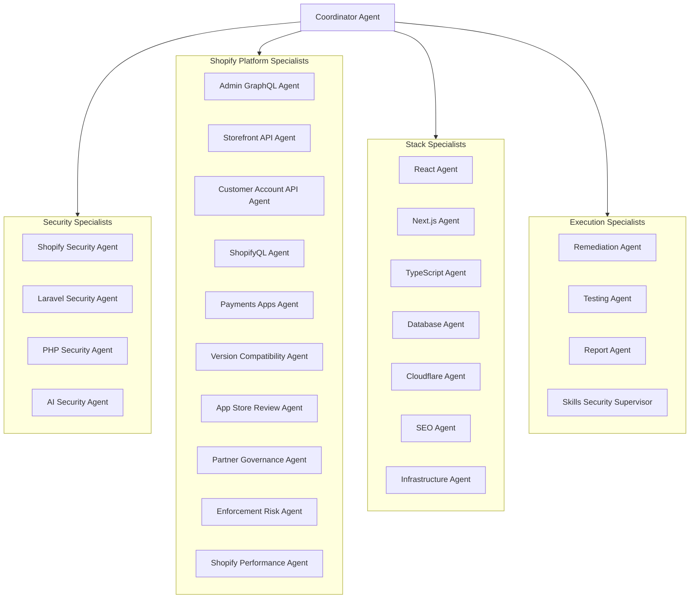

# AI AGENT SPECIFICATION

**Package:** `subhash/shopify-ai-audit`  
**Namespace:** `Subhash\ShopifyAiAudit\AI\Agents`  

---

## 1. Agent Multi-Agent Topology

---

## 2. Complete Roster of 27 Agents

1. **Coordinator Agent:** Decomposes requests, selects specialists, validates handoffs, aggregates evidence.
2. **Security Agent:** Cross-cutting threat modeling and vulnerability correlation.
3. **Laravel Agent:** Laravel framework best practices, middleware, routes, Eloquent.
4. **PHP Agent:** Core PHP typing, AST parsing, deprecations, modern idioms.
5. **Shopify Security Agent:** OAuth, webhooks, app proxy, tokens, GDPR compliance.
6. **Shopify App Store Review Agent:** App Store guidelines, metadata, screencast/test instructions.
7. **Shopify Admin GraphQL Agent:** Query optimization, cost calculation, field deprecations.
8. **Shopify Storefront Agent:** Headless architectures, Hydrogen, public token security.
9. **Shopify Customer Account Agent:** Customer account UI extensions, well-known endpoint discovery.
10. **ShopifyQL Agent:** Analytical query safety, syntax validation, metric definitions.
11. **Shopify Payments Agent:** Payments apps API session contracts, capture/refund handling.
12. **Shopify Partner Governance Agent:** Partner terms, AUP, rev-share, review manipulation.
13. **Shopify Enforcement Risk Agent:** Delisting risks, suspension indicators, appeal preparation.
14. **Shopify Performance Agent:** Lighthouse storefront weighting, script blocking, liquid rendering.
15. **Shopify Version Compatibility Agent:** Quarterly API version upgrades, breaking changes.
16. **React Agent:** React component lifecycle, hook dependencies, memory leaks.
17. **Next.js Agent:** Server components, Server Actions, SSR hydration, client boundary leaks.
18. **TypeScript Agent:** Type safety, strict mode compliance, unsafe `any` casts.
19. **Database Agent:** Index analysis, query plans, N+1 queries, MySQL/MariaDB/Redis.
20. **Cloudflare Agent:** WAF rules, Zero Trust, SSL/TLS full mode, DDoS/bot settings.
21. **SEO Agent:** Core Web Vitals, canonical tags, structured JSON-LD, sitemaps.
22. **Infrastructure Agent:** Dockerfiles, CI/CD pipelines, environment variable isolation.
23. **AI Security Agent:** Prompt injection resistance, tool poisoning, indirect injection.
24. **Remediation Agent:** Unified diff patch authoring, rollback steps, explanations.
25. **Testing Agent:** Automated PHPUnit and Pest test case generation for findings.
26. **Report Agent:** Executive summaries, technical breakdowns, SARIF compilation.
27. **Skills Security Supervisor:** Supply chain verification of custom skill YAMLs and instructions.
