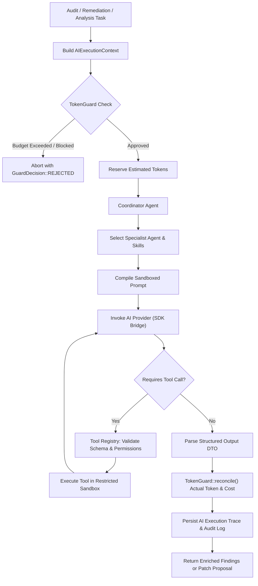

# AI ARCHITECTURE SPECIFICATION

**Package:** `subhash/shopify-ai-audit`  
**Namespace:** `Subhash\ShopifyAiAudit\AI`  

---

## 1. Subsystem Architecture

The AI subsystem operates as an optional augmentation layer above the deterministic audit engine. All AI execution is bounded, schema-validated, sandboxed, and guarded by token budgeting.

---

## 2. Invariants & Security Guardrails
1. **Deterministic Priority:** An audit must produce valid deterministic results even if AI providers are disabled, misconfigured, or unreachable.
2. **Prompt Injection Defense:** Scanned codebase files, user inputs, and external documentation are enclosed in strict content delimiters (`<untrusted_code_block>`) with explicit system instructions prohibiting execution of prompt overrides.
3. **Approval-Gated Tool Execution:** Read-only tools (`project.search`, `audit.get_findings`) may run automatically; any tool modifying files or databases requires explicit user approval.
4. **Execution Boundaries:** Maximum 10 iterations, 20 tool calls, and 120-second timeout per agent invocation to prevent runaway loops.
