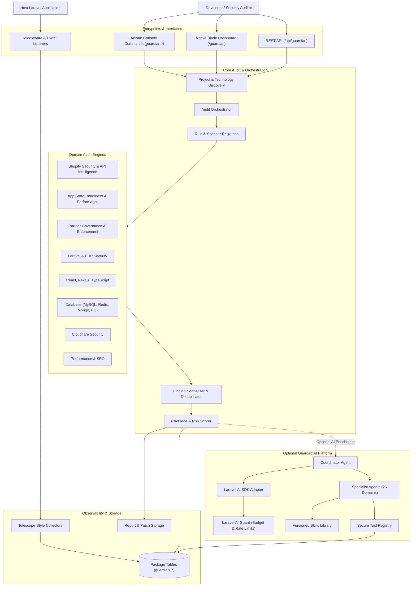
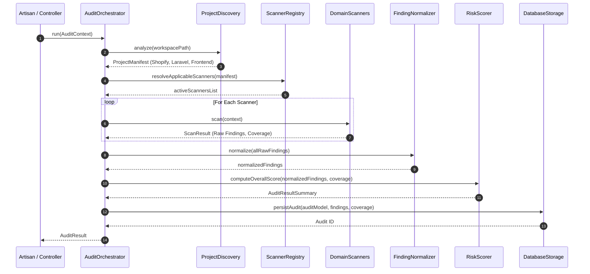

# ARCHITECTURE SPECIFICATION: SHOPIFY AI AUDIT

**Package:** `subhash/shopify-ai-audit`  
**Namespace:** `Subhash\ShopifyAiAudit`  
**Architectural Style:** Modular Monolith within a Reusable Laravel Package  

---

## 1. System Context & Component Interaction

The Guardian package integrates directly into a host Laravel application. It operates deterministically by default without mandatory cloud or AI dependencies, while providing optional AI extensions and native observability.



---

## 2. Directory Layout & Module Responsibilities

```text
shopify-ai-audit/
├── config/
│   └── shopify-ai-audit.php             # Core configuration
├── database/
│   └── migrations/                      # Tables with configurable guardian_ prefix
├── resources/
│   ├── views/                           # Native Blade dashboard templates
│   ├── audit-skills/                    # Versioned YAML/MD skills definitions
│   └── report-templates/                # Blade and markdown templates for reports
├── routes/
│   ├── web.php                          # Dashboard routes
│   └── api.php                          # Optional REST API routes
├── src/
│   ├── Core/                            # Core orchestrator, discovery, context, risk scoring
│   ├── Console/Commands/                # Artisan commands (guardian:*)
│   ├── Contracts/                       # Interfaces for scanners, rules, tools, guards
│   ├── DTOs/                            # Strongly-typed Data Transfer Objects
│   ├── Enums/                           # Controlled states (Severity, Status, Category, etc.)
│   ├── Events/                          # Domain events (AuditStarted, FindingDetected, etc.)
│   ├── Exceptions/                      # Package-specific exceptions
│   ├── Http/                            # Controllers, Middleware, FormRequests, Resources
│   ├── Models/                          # Eloquent models for audits, findings, monitor, etc.
│   ├── Providers/                       # Package Service Providers
│   ├── Scanners/                        # Domain scanner implementations
│   │   ├── Security/                    # General code security
│   │   ├── Laravel/                     # Laravel framework security
│   │   ├── PHP/                         # PHP language checks
│   │   ├── React/                       # React / Next.js / TypeScript
│   │   ├── Database/                    # Database optimization and exposure
│   │   ├── Cloudflare/                  # Cloudflare security checks
│   │   ├── Performance/                 # Core Web Vitals & runtime metrics
│   │   └── SEO/                         # Technical SEO & metadata
│   ├── Shopify/                         # Specialized Shopify Platform Modules
│   │   ├── Discovery/                   # Shopify project & app type detection
│   │   ├── Security/                    # OAuth, webhooks, app proxy, tokens, GDPR
│   │   ├── API/                         # Admin GraphQL, Storefront, Customer Account, etc.
│   │   ├── AppStore/                    # Requirements & review readiness
│   │   ├── Governance/                  # Partner terms, enforcement risk & sunset planner
│   │   ├── Extensions/                  # Theme app extensions, Checkout UI, Functions
│   │   └── Performance/                 # Storefront Lighthouse impact analyzer
│   ├── AI/                              # AI Subsystem
│   │   ├── SDK/                         # Laravel AI SDK bridge
│   │   ├── Guard/                       # TokenGuard & budget management
│   │   ├── Agents/                      # Coordinator and 26 specialist agents
│   │   ├── Tools/                       # Schema-validated tool registry
│   │   ├── Skills/                      # Skill loader and security supervisor
│   │   └── Providers/                   # Provider abstractions and model catalog
│   ├── Monitoring/                      # Telescope/Pulse-style observability
│   │   ├── Collectors/                  # Requests, Queries, APIs, Exceptions, Jobs, AI
│   │   ├── Middleware/                  # Request tracking middleware
│   │   └── Storage/                     # Asynchronous & synchronous ingestion
│   ├── Remediation/                     # Patch generation, diffing, verification, IDE prompts
│   └── Reports/                         # PDF, HTML, JSON, Markdown, SARIF generation
└── tests/                               # Comprehensive PHPUnit & Orchestra Testbench suite
```

---

## 3. Data Flow & Execution Pipeline



---

## 4. Security & Privacy Guarantees

1. **Zero Secret Leakage:** All environment variables, tokens, passwords, and private keys detected during scanning or monitoring are masked (`[REDACTED]`) before database storage or presentation in dashboards/reports.
2. **Deterministic By Default:** All core rules run without external network calls or AI services unless explicitly invoked.
3. **Fail-Closed AI Guard:** If `require_guard` is configured and token budgets are exhausted or unreachable, AI execution is rejected immediately with code `GUARD_BUDGET_EXCEEDED`.
4. **Non-Destructive Remediation:** Patches are presented as unified diff previews. Source files are NEVER modified without user authorization.
