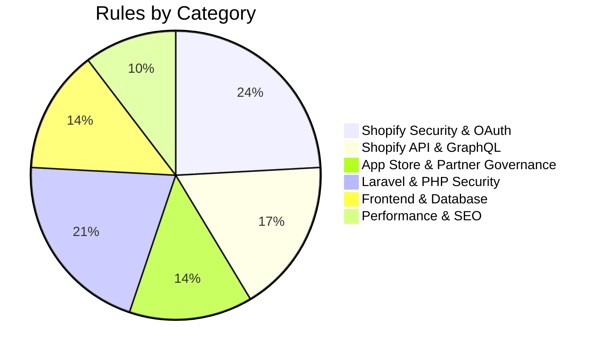

# AUDIT RULE CATALOG: SHOPIFY AI AUDIT

**Package Name:** `subhash/shopify-ai-audit`  
**Namespace:** `Subhash\ShopifyAiAudit`  

---

## 1. Catalog Overview

The Guardian engine categorizes rules across multiple security and compliance domains. Each rule has a unique ID, standardized severity, confidence score, detection mode (AST / Regex / Semantic / Config / Dynamic), and remediation guidance.

---

## 2. Rule Definitions by Category

### 2.1 Shopify Security (`SHOPIFY-SEC-*`)

| Rule ID | Rule Title | Default Severity | Confidence | Target Files | Description & Checks |
|---|---|---|---|---|---|
| `SHOPIFY-SEC-001` | Insecure OAuth HMAC Verification | Critical | High | Controllers, Middleware | Verifies `hash_equals` and raw query string used for Shopify HMAC OAuth check. |
| `SHOPIFY-SEC-002` | Missing OAuth State Nonce | High | High | Auth Controllers | Checks for state parameter generation and session verification in OAuth redirect. |
| `SHOPIFY-SEC-003` | Unvalidated Shop Domain | High | High | Middleware, Auth | Ensures shop domain matches `[a-zA-Z0-9][a-zA-Z0-9\-]*\.myshopify\.com` regex. |
| `SHOPIFY-SEC-004` | Webhook Missing HMAC Check | Critical | High | Webhook Handlers | Detects webhook routes bypassing `X-Shopify-Hmac-Sha256` validation. |
| `SHOPIFY-SEC-005` | Webhook Unsafe Body Access | High | High | Webhook Handlers | Detects parsed `$request->all()` instead of raw `$request->getContent()` during HMAC calculation. |
| `SHOPIFY-SEC-006` | Missing Mandatory GDPR Webhooks | Critical | High | Route files, Webhook config | Checks registration and handlers for `customers/data_request`, `customers/redact`, `shop/redact`. |
| `SHOPIFY-SEC-007` | App Proxy Signature Bypass | Critical | High | Proxy Controllers | Validates query parameter signature verification in App Proxy routes. |
| `SHOPIFY-SEC-008` | Embedded App Missing Frame-Ancestors | High | High | Middleware, Headers | Verifies CSP `frame-ancestors https://*.myshopify.com https://admin.shopify.com`. |
| `SHOPIFY-SEC-009` | Plaintext Access Token Storage | Critical | High | Models, Migrations | Ensures Shopify offline/online tokens are stored encrypted via Laravel casts. |
| `SHOPIFY-SEC-010` | Hardcoded Shopify API Secrets | Critical | High | Source files, Config | Flags hardcoded `shpat_`, `shpss_`, or API client secrets in code. |
| `SHOPIFY-SEC-011` | ScriptTag API Deprecation Usage | Medium | High | API Calls | Flags usage of deprecated ScriptTag API; recommends Theme App Extensions. |
| `SHOPIFY-SEC-012` | Unescaped Liquid in Theme Extensions | High | Medium | `.liquid` files | Detects `{{ input }}` instead of `{{ input | escape }}` in Liquid templates. |
| `SHOPIFY-SEC-013` | Missing App Bridge Session Token | High | High | Frontend, Blade | Verifies App Bridge session token usage instead of third-party cookies. |

---

### 2.2 Shopify API Intelligence (`SHOPIFY-API-*`)

| Rule ID | Rule Title | Default Severity | Confidence | Target Files | Description & Checks |
|---|---|---|---|---|---|
| `SHOPIFY-API-001` | Deprecated Shopify API Version | High | High | Config, Env, Services | Flags unsupported API versions (older than 1 year from latest stable). |
| `SHOPIFY-API-002` | Admin REST API Deprecation | High | High | Services, Http calls | Detects Admin REST endpoints `/admin/api/{version}/*.json`; advises GraphQL migration. |
| `SHOPIFY-API-003` | Storefront Private Token Frontend Leak | Critical | High | JS, TS, Blade, React | Detects Storefront private access token `shpat_` exposed in client-side code. |
| `SHOPIFY-API-004` | Customer Account API SSRF Risk | High | High | Services, Client | Ensures `/.well-known/customer-account-api` endpoint discovery is validated for domain host. |
| `SHOPIFY-API-005` | ShopifyQL Raw Parameter Injection | High | High | GraphQL queries | Identifies string interpolation inside ShopifyQL queries instead of parameterized variables. |
| `SHOPIFY-API-006` | Payments Apps API Unverified Resolution | Critical | High | Payments handlers | Ensures payments session resolution mutations check state and idempotency keys. |

---

### 2.3 Shopify App Store & Partner Governance (`SHOPIFY-GOV-*`)

| Rule ID | Rule Title | Default Severity | Confidence | Target Files | Description & Checks |
|---|---|---|---|---|---|
| `SHOPIFY-GOV-001` | Missing App Store Privacy Policy URL | Medium | High | App Config, Manifest | Verifies valid HTTPS privacy policy URL is declared. |
| `SHOPIFY-GOV-002` | Missing Mandatory App Listing Metadata | Medium | High | Manifest, Config | Validates required metadata: icon, name, support email, emergency contact. |
| `SHOPIFY-GOV-003` | Off-Platform Billing Detection | Critical | Medium | Billing Controllers | Flags payment gateways (Stripe, PayPal) used for Shopify app fees instead of Billing API. |
| `SHOPIFY-GOV-004` | Prohibited Data Persistence Post-Redact | High | High | Webhooks, Jobs | Verifies deletion or anonymization routines for `shop/redact` within 48 hours. |
| `SHOPIFY-GOV-005` | Storefront Performance Impact Threshold | High | Medium | Theme extensions, JS | Evaluates storefront bundle size & script blocking impact (>10pt Lighthouse drop risk). |

---

### 2.4 Laravel & PHP Security (`LARAVEL-SEC-*`)

| Rule ID | Rule Title | Default Severity | Confidence | Target Files | Description & Checks |
|---|---|---|---|---|---|
| `LARAVEL-SEC-001` | Raw SQL Parameter Concatenation | Critical | High | Repositories, Models | Identifies `DB::raw()`, `whereRaw()` with string concatenation. |
| `LARAVEL-SEC-002` | Unescaped Blade Output of User Input | High | High | Blade templates | Flags `{!! $request->... !!}` or unescaped variables in Blade templates. |
| `LARAVEL-SEC-003` | Production Debug Mode Enabled | Critical | High | `.env`, Config | Checks `APP_DEBUG=true` in production configurations. |
| `LARAVEL-SEC-004` | Mass Assignment Vulnerability | High | High | Eloquent Models | Detects `protected $guarded = [];` without form request validation. |
| `LARAVEL-SEC-005` | Arbitrary Command Execution | Critical | High | Services, Jobs | Detects unescaped arguments passed to `exec()`, `shell_exec()`, `system()`. |
| `LARAVEL-SEC-006` | Path Traversal in File Operations | High | High | Storage, Controllers | Identifies unsanitized user inputs passed to `Storage::get()` or `file_get_contents()`. |
| `LARAVEL-SEC-007` | Missing CSRF Verification on State Change | Medium | High | Routes, Controllers | Detects POST/PUT/DELETE routes exempt from VerifyCsrfToken without HMAC/token guard. |
| `LARAVEL-SEC-008` | SSRF Vulnerability in HTTP Client | High | High | Http calls, Guzzle | Flags user-controlled URLs in `Http::get()` without IP/domain allowlisting. |

---

### 2.5 Frontend, Database & Cloudflare (`INFRA-*`)

| Rule ID | Rule Title | Default Severity | Confidence | Target Files | Description & Checks |
|---|---|---|---|---|---|
| `FRONTEND-001` | React DangerouslySetInnerHTML | High | High | React/TSX files | Identifies `dangerouslySetInnerHTML` without DOMPurify sanitization. |
| `FRONTEND-002` | Client-Side Secret Key Exposure | Critical | High | JS, TS, Env | Flags `VITE_`, `NEXT_PUBLIC_`, or `MIX_` containing sensitive API secrets. |
| `DATABASE-001` | Exposed phpMyAdmin Route | Critical | High | Web server, Routes | Detects accessible `/phpmyadmin` or `/pma` routes without IP restrictions. |
| `DATABASE-002` | Unindexed Foreign Key Columns | Medium | High | Migrations | Identifies foreign key columns missing indexes, causing full table scans. |
| `CLOUDFLARE-001` | Insecure SSL/TLS Mode (Flexible) | High | High | Cloudflare Config | Warns against Cloudflare 'Flexible' SSL mode exposing origin traffic in plaintext. |
| `PERF-001` | N+1 Query Anti-Pattern in Loop | Medium | Medium | Blade, Controllers | Identifies lazy-loaded relationship access inside loops. |
