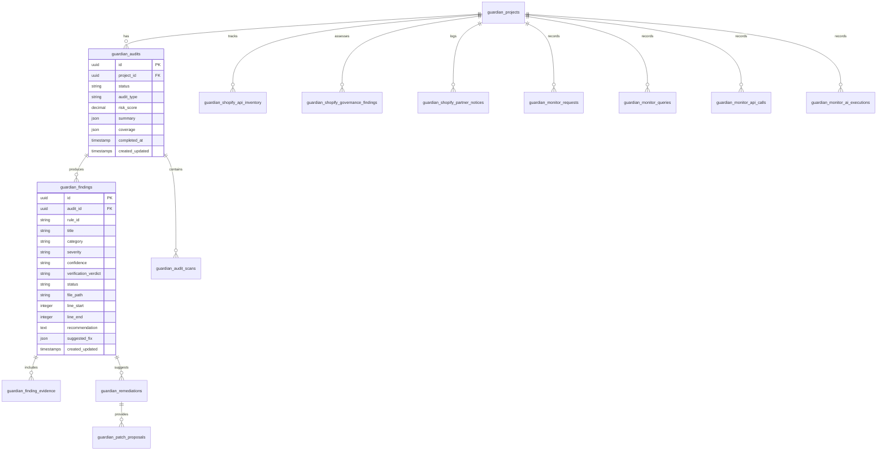

# DATABASE SCHEMA SPECIFICATION

**Package:** `subhash/shopify-ai-audit`  
**Namespace:** `Subhash\ShopifyAiAudit\Models`  
**Default Table Prefix:** `guardian_` (configurable in `config/shopify-ai-audit.php`)

---

## 1. Entity-Relationship Overview

---

## 2. Table Catalog

### 2.1 Core Audit Tables
1. `guardian_projects`: Tracked repositories/applications (`id`, `name`, `path`, `framework`, `shopify_app_type`, `meta`).
2. `guardian_audits`: Individual audit executions (`id`, `project_id`, `status`, `risk_score`, `summary`, `coverage`, `created_at`).
3. `guardian_audit_scans`: Sub-scanner executions (`id`, `audit_id`, `scanner_class`, `duration_ms`, `findings_count`, `coverage_percentage`).
4. `guardian_findings`: Normalized audit findings (`id`, `audit_id`, `rule_id`, `title`, `severity`, `confidence`, `status`, `file_path`, `line_start`, `line_end`, etc.).
5. `guardian_finding_evidence`: Specific code snippets, AST nodes, or HTTP payloads associated with a finding.
6. `guardian_remediations`: Fix recommendations, unified diffs, and verification steps.
7. `guardian_patch_proposals`: Generated patch diffs with approval status (`PENDING`, `APPROVED`, `REJECTED`, `APPLIED`).

### 2.2 Shopify Intelligence & Governance Tables
8. `guardian_shopify_api_inventory`: APIs identified in code (`admin_graphql`, `storefront`, `customer_account`, etc.).
9. `guardian_shopify_api_versions`: Supported, expiring, and deprecated quarterly versions.
10. `guardian_shopify_governance_findings`: Policy risk items (AUP, review manipulation, rev-share).
11. `guardian_shopify_partner_notices`: Recorded official notices from Shopify Partner support (confidential, role-gated).
12. `guardian_shopify_sunset_plans`: Deprecation schedules and merchant migration milestones.

### 2.3 Monitoring Tables
13. `guardian_monitor_requests`: Inbound HTTP request metrics (`method`, `uri`, `status`, `duration_ms`, `memory_bytes`).
14. `guardian_monitor_queries`: Executed SQL queries (`sql`, `duration_ms`, `connection`, `n_plus_one_flag`).
15. `guardian_monitor_api_calls`: Outgoing Shopify/external calls (`provider`, `endpoint`, `status`, `query_cost`, `throttle_remaining`).
16. `guardian_monitor_exceptions`: Unhandled exceptions and stack traces.
17. `guardian_monitor_ai_executions`: AI prompts, model usage, tokens, cost, and guard decisions.

### 2.4 AI & Skills Tables
18. `guardian_ai_budgets`: Token and financial budgets tracked per daily/monthly window.
19. `guardian_skills`: Registered skills, SHA-256 hashes, security verification state.
20. `guardian_reports`: Generated report artifacts (`type`, `path`, `format`, `download_token`).
