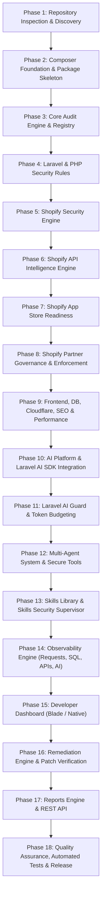

# IMPLEMENTATION PLAN: SHOPIFY AI AUDIT

**Package Name:** `subhash/shopify-ai-audit`  
**PHP Namespace:** `Subhash\ShopifyAiAudit`  
**GitHub Repository:** `subhashladumor1/shopify-ai-audit`  
**Target Platform:** Laravel 11.x / 12.x on PHP 8.2, 8.3, 8.4  

---

## 1. Executive Summary & Goals

`shopify-ai-audit` is a comprehensive, modular Laravel Composer package engineered for Shopify app developers, agencies, and enterprise merchants. It provides deep static and dynamic security auditing, official Shopify API intelligence, App Store readiness verification, Partner Program governance and enforcement risk modeling, native Telescope/Pulse-style observability, guarded multi-agent AI analysis, automated patch remediation with approval workflows, and multi-format compliance reporting (including SARIF and CycloneDX).

---

## 2. Implementation Phases

---

## 3. Detailed Phase Breakdown

### Phase 1: Repository Inspection & Discovery
- Discover current state: New repository with only `.gitignore`, `LICENSE`, `README.md`.
- Establish target dependencies: PHP 8.2+, Laravel 11.0+/12.0+, Orchestra Testbench 9.0+/10.0+, PHPUnit 10/11.
- Establish architectural documents and standards.

### Phase 2: Composer Foundation
- Author `composer.json` with PSR-4 autoloading (`Subhash\\ShopifyAiAudit\\` -> `src/`, `Subhash\\ShopifyAiAudit\\Tests\\` -> `tests/`).
- Configure package discovery in `composer.json`:
  - Provider: `Subhash\ShopifyAiAudit\ShopifyAiAuditServiceProvider`
  - Facade: `Subhash\ShopifyAiAudit\Facades\Guardian`
- Define configuration in `config/shopify-ai-audit.php`.
- Define database migrations with `guardian_` table prefix.
- Configure `phpunit.xml`, `phpstan.neon`, `pint.json`.

### Phase 3: Core Audit Engine
- Contracts: `AuditScanner`, `AuditRule`, `FindingNormalizerInterface`, `RiskScorerInterface`.
- DTOs: `AuditContext`, `RuleMetadata`, `RuleResult`, `ScanResult`, `AuditResult`, `AuditFinding`, `CoverageReport`.
- Registries: `ScannerRegistry`, `RuleRegistry`.
- Orchestration: `AuditManager`, `AuditOrchestrator`, `ProjectDiscovery`, `FrameworkDetector`.
- CLI: `guardian:audit` with switches (`--security`, `--shopify`, `--laravel`, `--frontend`, `--database`, `--cloudflare`, `--performance`, `--seo`).

### Phase 4: Laravel and PHP Security Scanner
- Static code analysis rules for Laravel and PHP:
  - SQL Injection (`DB::raw`, unescaped parameters)
  - Cross-Site Scripting (unencoded Blade `{!! $var !!}`, unsafe responses)
  - CSRF verification exemptions
  - Server-Side Request Forgery (SSRF via Guzzle/Http clients)
  - Remote Command Execution (`exec`, `system`, `passthru`, `proc_open`)
  - Path Traversal (`Storage::get`, `file_get_contents` with unvalidated input)
  - Insecure File Uploads (MIME validation, executable extensions)
  - Mass Assignment (`$guarded = []`)
  - Broken Authorization (missing policies/middleware)
  - Debug Mode & Sensitive Data Exposure (`APP_DEBUG=true`, exposed `.env`)
  - Weak Session/Encryption configurations.

### Phase 5: Shopify Security Engine
- Official Shopify security checks:
  - OAuth 2.0 flow: HMAC verification, state nonce validation, hostname validation (`myshopify.com`), authorization code exchange.
  - Session tokens: App Bridge session token decoding, signature verification, expiration, audience/issuer check.
  - Webhooks: Raw body HMAC SHA-256 verification, timing-attack-safe comparison (`hash_equals`), shop header validation, idempotency and replay protection.
  - App Proxy: Query string signature verification, shop domain validation, timestamp threshold check.
  - Mandatory GDPR/Privacy webhooks: `customers/data_request`, `customers/redact`, `shop/redact`.
  - Protected Customer Data access checks and log sanitization.
  - Embedded app security: CSP `frame-ancestors` directive for `*.myshopify.com` and `admin.shopify.com`.
  - Liquid and Theme App Extensions: unsafe filters, unescaped tags, ScriptTags deprecation.
  - Extensions security: Checkout UI, Customer Account UI, POS UI, Shopify Functions.

### Phase 6: Shopify API Intelligence Engine
- API Registry supporting:
  - Admin GraphQL API (`https://shopify.dev/docs/api/admin-graphql/latest`)
  - Storefront API (GraphQL only, public vs private token auditing)
  - Customer Account API (`.well-known/customer-account-api` endpoint discovery, SSRF protection)
  - ShopifyQL (syntax validation, metric/dimension validation)
  - Payments Apps API (restricted partner capability, session resolutions/rejections)
- Versioning and deprecation tracking (Quarterly version cadence: `2024-01`, `2024-04`, `2024-07`, `2024-10`, `2025-01`, `2025-04`, `unstable`).
- Field deprecation detection in GraphQL queries and AST.
- CLI commands:
  - `guardian:shopify:apis`
  - `guardian:shopify:api:versions`
  - `guardian:shopify:api:check-version`
  - `guardian:shopify:api:deprecated`
  - `guardian:shopify:api:schema-diff`
  - `guardian:shopify:api:upgrade-report`

### Phase 7: Shopify App Store Readiness Engine
- Official requirement registry:
  - Installation & OAuth best practices.
  - App Bridge 3.x / 4.x compliance, zero third-party cookie reliance.
  - Billing API usage (Shopify RecurringApplicationCharge / AppSubscription).
  - Listing metadata checks: App icon, descriptive text, test instructions, support links, privacy policy URL.
  - Storefront performance impact checks (Lighthouse score reduction <= 10 points on Home, Product, Collection pages; weights: 17% Home, 40% Product, 43% Collection).
- Category-specific checks (Online Store, Admin, Checkout, Subscriptions, Payments).
- CLI commands: `guardian:shopify:app-store:audit`, `guardian:shopify:app-store:readiness`.

### Phase 8: Shopify Partner Governance & Enforcement
- Partner Program Agreement, API Terms, and Acceptable Use Policy compliance checks.
- Documented enforcement registry (delisting, app removal, review removal, payout pause, account termination).
- Risk scoring engine for violations (missing compliance webhooks, review manipulation, unauthorized off-platform billing, data leakage).
- App Removal Impact analysis & Merchant Continuity Planning.
- Voluntary App Sunset Planner.
- Confidential Partner Notices & Appeal Evidence Organizer.
- CLI commands: `guardian:shopify:partner:compliance-audit`, `guardian:shopify:partner:enforcement-risk`, `guardian:shopify:partner:removal-impact`, `guardian:shopify:partner:sunset-plan`, `guardian:shopify:partner:notice`, `guardian:shopify:partner:appeal-evidence`.

### Phase 9: Frontend, Database, Cloudflare, SEO & Performance
- Frontend: React / Next.js / TypeScript security (`dangerouslySetInnerHTML`, exposed client secrets, SSR hydration, unescaped DOM sinks).
- Database: MySQL, MariaDB, Redis, MongoDB, PostgreSQL security (SQLi, slow queries, missing indexes, N+1 patterns, phpMyAdmin exposure).
- Cloudflare: DNS proxying, SSL/TLS full/strict mode, WAF rule review, bot fight mode, rate limits.
- Performance & Technical SEO: TTFB, query duration, bundle size, canonical tags, robots.txt, Open Graph, meta tags.

### Phase 10 & 11: AI Platform & Laravel AI Guard Integration
- Multi-provider support (OpenAI, Anthropic, Gemini, Groq, DeepSeek, Mistral, Ollama, custom OpenAI-compatible).
- Dynamic provider configuration and model capabilities detection.
- `TokenGuard` contract and integration with `laravel-ai-guard`:
  - Token reservations, pre-flight budget checks, post-execution reconciliation.
  - Daily, monthly, project, agent, and user-level token and cost limits.
  - Strict fail-closed policy when guard is required but unreachable.

### Phase 12 & 13: Multi-Agent System, Tool Registry & Skills Library
- Coordinator Agent with 26 specialized sub-agents.
- Secure Tool Registry: schema-validated tools, read-only vs write permissions, execution sandbox, audit logs.
- Versioned Skills Library: 40 Core Skills, 20 Security Skills, 21 Shopify Subskills.
- Skills Security Supervisor: static validation of skill YAML and instructions to prevent prompt injection and unauthorized command execution.

### Phase 14: Observability Engine
- Telescope/Pulse-style collectors:
  - Request collector (status, duration, memory, correlation ID)
  - Query collector (SQL, duration, connection, bindings redactor, N+1 detection)
  - API call collector (Shopify GraphQL cost, throttle quota, latency)
  - Exception collector (stack trace, line, message)
  - Job & Event collector
  - AI Execution collector (tokens, cost, duration, guard decisions)
- Sampling, sensitive data redaction, data retention pruning.

### Phase 15 & 16: Dashboard & Remediation Engine
- Native Blade dashboard views for all sections (light/dark responsive UI).
- Automated remediation engine: unified patch generation, preview diff, IDE prompt generator (Antigravity, Claude Code, OpenAI Codex), post-fix verification.

### Phase 17: Reports Engine & REST API
- Multi-format exporter: PDF, HTML, JSON, CSV, XLSX, Markdown, SARIF, CycloneDX.
- Secure REST API with Sanctum/API token authentication, rate limiting, and structured JSON responses.

### Phase 18: Quality Assurance, Automated Tests & Release
- Comprehensive unit and integration test suite via PHPUnit & Orchestra Testbench.
- CI/CD workflow with GitHub Actions.
- Complete documentation and final engineering status report.
