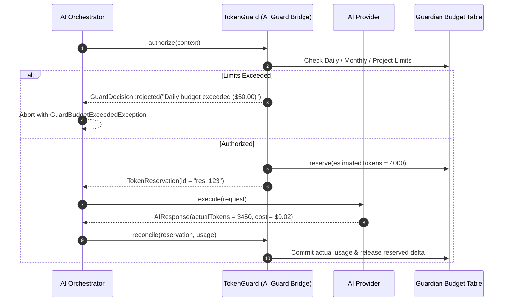

# LARAVEL AI GUARD INTEGRATION

**Package:** `subhash/shopify-ai-audit`  
**Namespace:** `Subhash\ShopifyAiAudit\AI\Guard`  

---

## 1. Guard Contract & Lifecycle

Guardian integrates with `laravel-ai-guard` or provides a high-reliability standalone token/cost rate-limiter based on the following contract:

```php
namespace Subhash\ShopifyAiAudit\Contracts;

use Subhash\ShopifyAiAudit\DTOs\AIExecutionContext;
use Subhash\ShopifyAiAudit\DTOs\AIUsage;
use Subhash\ShopifyAiAudit\DTOs\GuardDecision;
use Subhash\ShopifyAiAudit\DTOs\TokenReservation;

interface TokenGuard
{
    /**
     * Authorize whether the AI execution context is allowed to proceed.
     */
    public function authorize(AIExecutionContext $context): GuardDecision;

    /**
     * Reserve an estimated budget of tokens before invoking the AI provider.
     */
    public function reserve(AIExecutionContext $context): TokenReservation;

    /**
     * Reconcile actual token counts and cost once the invocation completes.
     */
    public function reconcile(TokenReservation $reservation, AIUsage $usage): void;
}
```



---

## 2. Fail-Closed Security Policy

When `shopify-ai-audit.ai.require_guard` is set to `true`:
- If the Guard service throws an exception or cache/database is unreachable, Guardian **FAILS CLOSED** and terminates the AI turn immediately.
- Tokens and budgets are tracked per:
  1. System-wide daily/monthly limit.
  2. Project-level allocation.
  3. User/Auditor ID.
  4. Specific Agent (e.g. `RemediationAgent` vs `Coordinator`).
