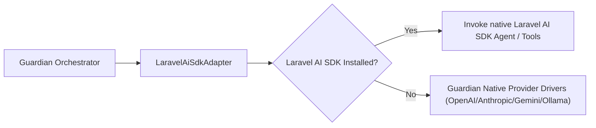

# LARAVEL AI SDK INTEGRATION

**Package:** `subhash/shopify-ai-audit`  
**Namespace:** `Subhash\ShopifyAiAudit\AI\SDK`  

---

## 1. SDK Bridge Architecture

Guardian integrates with Laravel AI SDK constructs when available in the host environment, while remaining fully decoupled through an internal adapter pattern.

---

## 2. Structured Outputs & Streaming

When using Laravel AI SDK or Guardian's native provider bridges:
1. **JSON Schema Enforcement:** Every finding enhancement, patch suggestion, and risk assessment defines a strict JSON schema using JSON Schema Draft 7.
2. **Streaming & CLI Progress:** For long reasoning tasks, progress bars and token updates are broadcast via Laravel Events (`AIExecutionProgressEvent`) to the console and dashboard.
3. **Decoupled Contracts:** The host application does not need to install the Laravel AI SDK if it only intends to use Guardian's deterministic rules or native direct LLM drivers.
