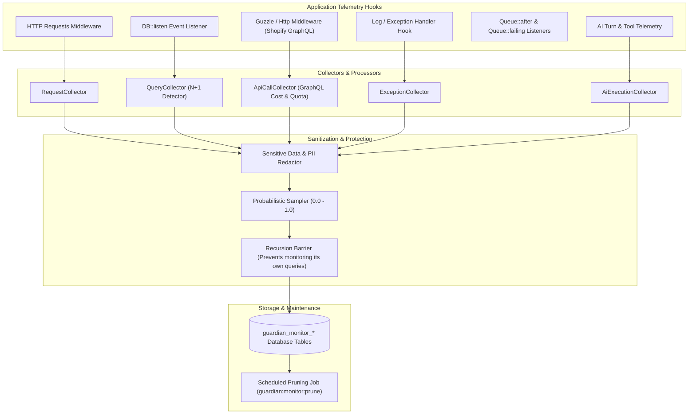

# OBSERVABILITY & MONITORING ARCHITECTURE

**Package:** `subhash/shopify-ai-audit`  
**Namespace:** `Subhash\ShopifyAiAudit\Monitoring`  

---

## 1. Telescope/Pulse-Style Architecture

Guardian includes an internal observability subsystem designed specifically for Shopify apps and Laravel backends. It functions seamlessly in synchronous environments without requiring Redis or queues, while supporting high-throughput batching when available.



---

## 2. Specialized Shopify API Monitoring
For all outgoing calls to Shopify Admin GraphQL:
- Extracts `X-Shopify-Shop-Api-Call-Limit` headers (e.g. `32/40`).
- Extracts GraphQL query cost extensions:
  ```json
  "extensions": {
    "cost": {
      "requestedQueryCost": 120,
      "actualQueryCost": 85,
      "throttleStatus": {
        "maximumAvailable": 2000,
        "currentlyAvailable": 1915,
        "restoreRate": 100
      }
    }
  }
  ```
- Warns proactively when `currentlyAvailable < 200` to prevent rate-limit crashes.
