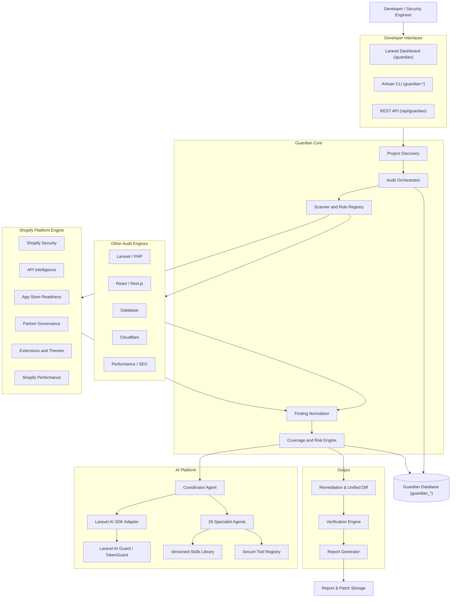
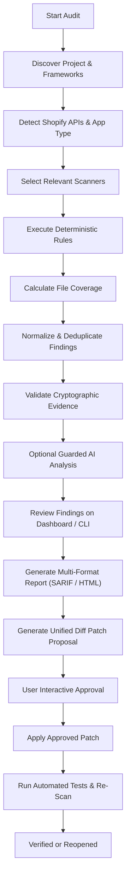
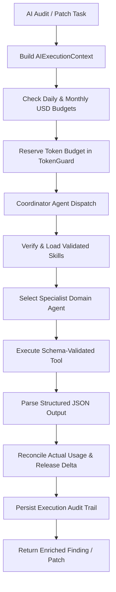
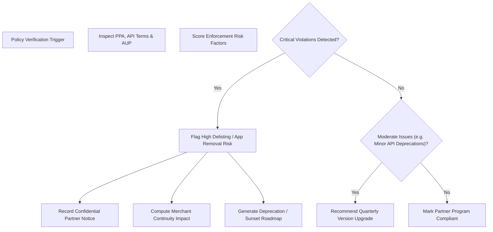

# Shopify AI Audit Guardian

> **Audit · Observe · Analyze · Secure · Fix**  
> AI-powered Shopify Security, App Store Compliance, API Intelligence, Partner Governance, Observability, and Automated Remediation for Laravel applications.

[](LICENSE)
[](https://www.php.net)
[](https://laravel.com)
[](phpstan.neon)
[](pint.json)

---

## 1. Product Overview

**Shopify AI Audit Guardian** (`subhash/shopify-ai-audit`) is an enterprise-grade Laravel Composer package engineered for Shopify app developers, agencies, and enterprise merchants. It provides deep, deterministic static and dynamic security auditing, official Shopify API intelligence, App Store readiness verification, Partner Program governance and enforcement risk modeling, native Telescope/Pulse-style observability, optional token-guarded multi-agent AI analysis, unified diff patch generation with approval workflows, and multi-format compliance reporting (including SARIF and CycloneDX).

The package installs directly into existing Laravel applications, providing:
- **Zero Cloud/AI Mandate:** Operates deterministically without external API dependencies.
- **Official Shopify Sources of Truth:** Built upon canonical Shopify App Store requirements, GraphQL API versions, and Partner Program terms.
- **Fail-Closed Token Guarding:** Optional AI features strictly respect daily and monthly token budgets with automated reservation and reconciliation.
- **Developer Experience:** Native Blade developer dashboard, rich Artisan CLI suite, and structured REST API.

---

## 2. Feature Matrix

| Feature Domain | Capabilities |
|---|---|
| **Core Audit Engine** | Project discovery, technology detection, scanner registry, finding normalizer, coverage tracker, and risk scoring (A+ to F). |
| **Shopify Platform Security** | OAuth 2.0 flow, session tokens, webhook HMAC SHA-256 verification, App Proxy signatures, mandatory GDPR webhooks (`customers/data_request`, `customers/redact`, `shop/redact`), embedded app CSP `frame-ancestors`, and unescaped Liquid detection. |
| **Shopify API Intelligence** | Admin GraphQL API, Storefront API (GraphQL-only, public vs private token auditing), Customer Account API (well-known endpoint discovery & SSRF defense), ShopifyQL, Payments Apps API, quarterly version lifecycle tracking, deprecation alerts, and upgrade reporting. |
| **App Store Readiness** | App Store submission checklist, App Bridge session tokens, zero third-party cookie reliance, mandatory metadata verification, off-platform billing detection, and weighted storefront Lighthouse impact evaluation (17% Home, 40% Product, 43% Collection). |
| **Partner Governance** | Partner Program Agreement, API Terms, and Acceptable Use Policy compliance; enforcement risk assessment (delisting, app removal, API revocation); app removal impact analysis; voluntary app sunset planner; and confidential notice organizer. |
| **Laravel & PHP Security** | SQL injection (`DB::raw` concatenation), XSS (`{!! !!}` unescaped Blade), `APP_DEBUG=true` in production, mass assignment (`$guarded = []`), command injection, path traversal, and SSRF in HTTP clients. |
| **Frontend & Infrastructure** | React/Next.js/TypeScript security (`dangerouslySetInnerHTML`, exposed client secrets), Database optimization (phpMyAdmin public exposure, unindexed foreign keys), Cloudflare security (Flexible SSL warnings), and Technical SEO. |
| **AI Platform & Multi-Agent** | Optional multi-agent system (Coordinator + 26 specialist agents) over Laravel AI SDK and direct LLM providers (OpenAI, Anthropic, Gemini, Groq, DeepSeek, Mistral, Ollama). |
| **AI Token Guard** | Standalone budget limiter or `laravel-ai-guard` bridge enforcing daily/monthly USD limits with token reservations, usage reconciliation, and fail-closed termination. |
| **Skills & Security Supervisor** | 40 Core Skills, 20 Security Skills, 21 Shopify Subskills, and a static security supervisor detecting prompt injection, obfuscated scripts, and shell breakouts. |
| **Native Observability** | Telescope/Pulse-style telemetry capturing HTTP requests, SQL queries (with N+1 detection), external Shopify GraphQL calls (cost & throttle quotas), and exceptions. |
| **Automated Remediation** | Unified diff patch authoring, interactive approval gates, post-fix verification, and copy-paste prompts for Antigravity, Claude Code, and OpenAI Codex. |
| **Reporting & REST API** | Export to HTML, PDF, JSON, SARIF 2.1.0, CSV, XLSX, Markdown, and CycloneDX; authenticated REST API endpoints with pagination and resource transformers. |

---

## 3. Package Architecture



---

## 4. Workflows

### 4.1 Audit & Remediation Lifecycle



### 4.2 Guarded AI & Token Budget Workflow



### 4.3 Shopify Partner Governance & Enforcement Workflow



---

## 5. Requirements

- **PHP:** `^8.2 || ^8.3 || ^8.4`
- **Laravel Framework:** `^11.0 || ^12.0`
- **PHP Extensions:** `mbstring`, `pdo`, `openssl`, `tokenizer`, `xml`, `curl`

---

## 6. Installation & Quick Start

Install the package via Composer into your existing Laravel project:

```bash
composer require subhash/shopify-ai-audit
```

### Publish Configuration
Publish the Guardian configuration file:

```bash
php artisan vendor:publish --tag=shopify-ai-audit-config
```

### Publish Dashboard Views (Optional)
Customize Blade dashboard templates:

```bash
php artisan vendor:publish --tag=shopify-ai-audit-views
```

---

## 7. Artisan CLI Commands

Guardian provides a unified console suite prefixed with `guardian:`:

### Audit Execution
```bash
# Run full project audit
php artisan guardian:audit

# Run specific domain scans
php artisan guardian:audit --shopify
php artisan guardian:audit --security
php artisan guardian:audit --laravel
php artisan guardian:audit --frontend
php artisan guardian:audit --database
php artisan guardian:audit --cloudflare
php artisan guardian:audit --performance
php artisan guardian:audit --seo

# Filter by minimum severity
php artisan guardian:audit --min-severity=high

# Output as JSON for CI/CD pipelines
php artisan guardian:audit --format=json
```

### Package Health
```bash
php artisan guardian:health
```

### Shopify API Intelligence
```bash
# List official Shopify APIs tracked by registry
php artisan guardian:shopify:apis

# List quarterly version lifecycle and sunset dates
php artisan guardian:shopify:api:versions

# Verify compatibility of a specific version
php artisan guardian:shopify:api:check-version 2025-01
```

### App Store Readiness & Partner Governance
```bash
# Audit against official App Store Review requirements
php artisan guardian:shopify:app-store:audit

# View Partner Program agreements and key compliance clauses
php artisan guardian:shopify:partner:policies

# Evaluate partner account and app enforcement risk
php artisan guardian:shopify:partner:enforcement-risk

# Generate a voluntary app sunset and merchant continuity roadmap
php artisan guardian:shopify:partner:sunset-plan "My Shopify App"
```

### Remediation & IDE Prompts
```bash
# Generate prompt for external IDE coding agents (Antigravity, Claude Code, Codex)
php artisan guardian:fix:prompt SHOPIFY-SEC-006 --agent=antigravity
```

### Observability & Monitoring
```bash
# View captured HTTP requests, SQL queries, and Shopify GraphQL metrics
php artisan guardian:monitor
```

### Reporting
```bash
# Export audit report in HTML, JSON, SARIF, Markdown, or CSV
php artisan guardian:report --format=html
php artisan guardian:report --format=sarif --output=security-results.sarif
php artisan guardian:report --format=markdown --output=AUDIT.md
```

---

## 8. Native Blade Developer Dashboard

The developer dashboard is accessible at `/guardian` in your browser. It includes:
- **Overview:** Dynamic risk gauge, score breakdown, file coverage, and top findings.
- **Findings:** Filterable list with severity badges, verified code locations, and copyable patch suggestions.
- **Shopify Intelligence:** Documentation links, API version statuses, and Partner Governance policies.
- **Observability:** Live stream of captured HTTP requests, executed queries, and Shopify API throttles.

Configure the dashboard path and authorization middleware in `config/shopify-ai-audit.php`:

```php
'dashboard' => [
    'enabled' => env('GUARDIAN_DASHBOARD_ENABLED', true),
    'path' => 'guardian',
    'middleware' => ['web', 'auth'],
],
```

---

## 9. REST API Reference

Guardian exposes optional REST API endpoints for remote pipelines and external dashboards under `/api/guardian`:

| Method | Endpoint | Description |
|---|---|---|
| `GET` | `/api/guardian/health` | Service health status and scanner counts |
| `POST` | `/api/guardian/audits` | Trigger a new audit and receive structured findings |
| `GET` | `/api/guardian/shopify/apis` | Discovered Shopify APIs and version metadata |
| `GET` | `/api/guardian/shopify/governance` | Partner policies and enforcement actions |
| `GET` | `/api/guardian/telemetry` | Recent monitored queries and API calls |

---

## 10. AI Platform & Token Budget Configuration

Guardian keeps AI functionality optional. To enable AI analysis, configure provider credentials and budget caps in `.env`:

```env
GUARDIAN_AI_ENABLED=true
GUARDIAN_AI_PROVIDER=openai
OPENAI_API_KEY=sk-proj-...
OPENAI_MODEL=gpt-4o

# Token Budget Safeguards (USD)
GUARDIAN_AI_DAILY_BUDGET_USD=10.00
GUARDIAN_AI_MONTHLY_BUDGET_USD=100.00
GUARDIAN_AI_REQUIRE_GUARD=true
```

---

## 11. Security & Privacy Guarantees

1. **Automatic Credential Masking:** Passwords, API tokens (`shpat_`, `shpss_`), and private keys are redacted (`[REDACTED]`) before persistence in logs, databases, or AI prompts.
2. **Directory Sandboxing:** File operations cannot escape the project root directory.
3. **SSRF Mitigation:** Discovery endpoints for Customer Account API strictly resolve to approved Shopify domains.
4. **Non-Destructive Fixes:** Patches are presented as unified diff previews; source files are never modified without explicit user approval.

---

## 12. Testing & Static Analysis

Run the comprehensive automated test suite and quality checks:

```bash
# Run unit and feature tests via PHPUnit
vendor/bin/phpunit

# Run static analysis via PHPStan (Level 5 Clean)
vendor/bin/phpstan analyse

# Check code formatting via Laravel Pint
vendor/bin/pint --test
```

---

## 13. Documentation Index

Detailed specifications and architectural guides are available in the repository:

- [`ARCHITECTURE.md`](ARCHITECTURE.md) — System architecture, sequence diagrams, and directory layouts.
- [`IMPLEMENTATION_PLAN.md`](IMPLEMENTATION_PLAN.md) — 18-phase implementation blueprint.
- [`IMPLEMENTATION_ROADMAP.md`](IMPLEMENTATION_ROADMAP.md) — Milestones, deliverables, and verification gates.
- [`AUDIT_RULE_CATALOG.md`](AUDIT_RULE_CATALOG.md) — Complete catalog of security and compliance rules.
- [`SHOPIFY_SECURITY_SPECIFICATION.md`](SHOPIFY_SECURITY_SPECIFICATION.md) — OAuth, webhooks, app proxy, tokens, and CSP specifications.
- [`SHOPIFY_API_COVERAGE_MATRIX.md`](SHOPIFY_API_COVERAGE_MATRIX.md) — Admin GraphQL, Storefront, Customer Account, and ShopifyQL matrices.
- [`SHOPIFY_APP_STORE_REQUIREMENTS.md`](SHOPIFY_APP_STORE_REQUIREMENTS.md) — App Store review checklist and Lighthouse impact weighting.
- [`SHOPIFY_PARTNER_GOVERNANCE.md`](SHOPIFY_PARTNER_GOVERNANCE.md) — Partner Program agreements, enforcement risks, and sunset planner.
- [`AI_ARCHITECTURE.md`](AI_ARCHITECTURE.md) — AI subsystem topology, guardrails, and execution boundaries.
- [`AI_PROVIDER_SPECIFICATION.md`](AI_PROVIDER_SPECIFICATION.md) — Provider adapters and model capabilities.
- [`AI_AGENT_SPECIFICATION.md`](AI_AGENT_SPECIFICATION.md) — Coordinator and 26 specialist agents specification.
- [`AI_SKILLS_SPECIFICATION.md`](AI_SKILLS_SPECIFICATION.md) — Core skills, security skills, and supervisor.
- [`LARAVEL_AI_SDK_INTEGRATION.md`](LARAVEL_AI_SDK_INTEGRATION.md) — Laravel AI SDK bridge and structured outputs.
- [`LARAVEL_AI_GUARD_INTEGRATION.md`](LARAVEL_AI_GUARD_INTEGRATION.md) — TokenGuard contract, reservations, and reconciliation.
- [`MONITORING_ARCHITECTURE.md`](MONITORING_ARCHITECTURE.md) — Telescope/Pulse telemetry pipeline.
- [`DATABASE_SCHEMA.md`](DATABASE_SCHEMA.md) — Entity-relationship diagrams and table specifications.
- [`REPORT_DESIGN_SPECIFICATION.md`](REPORT_DESIGN_SPECIFICATION.md) — Export formats and SARIF specifications.
- [`SECURITY_AND_PRIVACY.md`](SECURITY_AND_PRIVACY.md) — Package self-protection, secret masking, and SSRF defense.
- [`API_REFERENCE.md`](API_REFERENCE.md) — REST API endpoints and JSON payloads.
- [`TESTING_STRATEGY.md`](TESTING_STRATEGY.md) — Unit, feature, and security test architecture.
- [`CONTRIBUTING.md`](CONTRIBUTING.md) — Contribution guidelines and pull request instructions.
- [`CHANGELOG.md`](CHANGELOG.md) — Version history and release notes.

---

## 14. License

This open-source package is licensed under the [MIT License](LICENSE).
Copyright (c) 2026 Subhash Ladumor.
