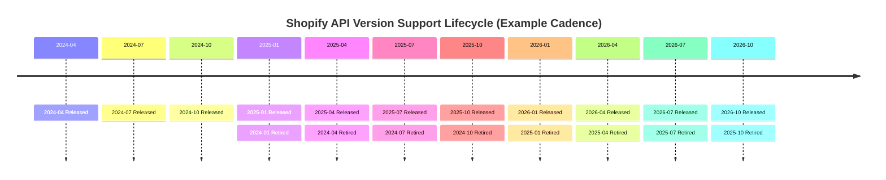

# SHOPIFY API COVERAGE MATRIX

**Package:** `subhash/shopify-ai-audit`  
**Namespace:** `Subhash\ShopifyAiAudit\Shopify\API`  

---

## 1. Supported Shopify APIs Overview

| API Name | Protocol | Endpoint Pattern | Auth Mechanism | Primary Use Case |
|---|---|---|---|---|
| **Admin GraphQL API** | GraphQL | `https://{shop}.myshopify.com/admin/api/{version}/graphql.json` | `X-Shopify-Access-Token` | Core merchant data, orders, products, billing |
| **Storefront API** | GraphQL Only | `https://{shop}.myshopify.com/api/{version}/graphql.json` | `X-Shopify-Storefront-Access-Token` (public) / Private Token (backend) | Custom headless storefronts, Hydrogen, cart/checkout |
| **Customer Account API** | GraphQL | Discovered via `/.well-known/customer-account-api` | Customer Access Token (OAuth2 Bearer) | Customer self-service, order history, profile |
| **ShopifyQL** | Query DSL via GraphQL | Embedded within Admin GraphQL `shopifyqlQuery` field | Same as Admin GraphQL | Analytics, sales reports, cohort analysis |
| **Payments Apps API** | GraphQL | `https://{shop}.myshopify.com/payments_apps/api/{version}/graphql.json` | Mutual TLS / Partner Token | Payment session resolutions, refunds, captures (Approved partners only) |

---

## 2. API Version Cadence & Lifecycle Tracking

Shopify releases stable API versions quarterly on January 1, April 1, July 1, and October 1. Each version is supported for 12 months before retirement.



### Guardian Version Analysis Rules
- **Status `CURRENT`:** Versions released within the last 9 months.
- **Status `EXPIRING_SOON`:** Versions within 90 days of their 12-month deprecation window.
- **Status `UNSUPPORTED`:** Versions older than 12 months. Any requests defaulting to an unsupported version are upgraded by Shopify fallback or rejected.
- **Status `UNSTABLE`:** Development builds; prohibited in production.

---

## 3. Customer Account API Discovery & Security

The Customer Account API does not use a fixed host pattern. App developers must query the discovery endpoint:

```http
GET https://{shop}.myshopify.com/.well-known/customer-account-api
```

### Discovery Validation Pipeline
1. Verify HTTPS protocol.
2. Verify host strictly matches `{subdomain}.myshopify.com`.
3. Disallow following arbitrary external HTTP redirects (SSRF mitigation).
4. Parse response schema:
   ```json
   {
     "graphql_endpoint": "https://customer.example.com/api/2026-01/graphql",
     "auth_server": "https://customer.example.com/auth"
   }
   ```
5. Ensure returned `graphql_endpoint` matches Shopify domain infrastructure.

---

## 4. Payments Apps API Restrictions

The Payments Apps API is strictly restricted to approved Shopify Payments Partners. Guardian audits:
- Payment session resolution mutations (`paymentSessionResolve`, `paymentSessionReject`).
- Pending state handling (`paymentSessionPending`).
- Idempotency key uniqueness across transaction calls.
- Strict rejection of credit card / raw PAN data logging to comply with PCI-DSS guidelines.
- Accurate handling of amount and currency integrity to prevent currency mismatch attacks.
