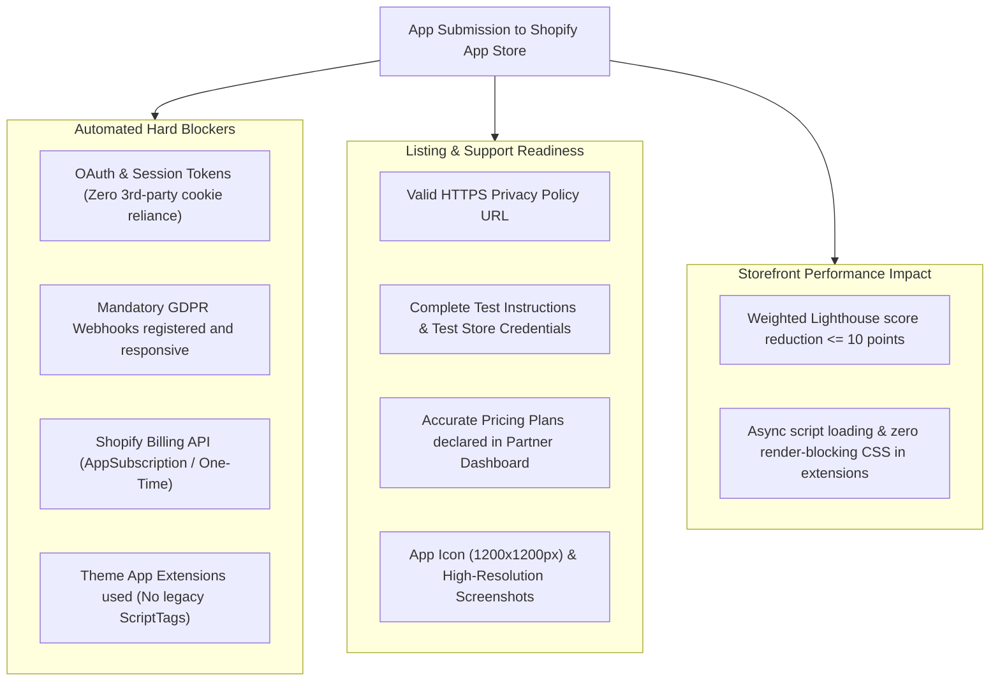

# SHOPIFY APP STORE REQUIREMENTS & REVIEW READINESS

**Package:** `subhash/shopify-ai-audit`  
**Namespace:** `Subhash\ShopifyAiAudit\Shopify\AppStore`  

---

## 1. App Store Core Requirements Checklist

---

## 2. Storefront Performance Weighting & Lighthouse Impact

For apps contributing frontend scripts to online storefronts (via Theme App Extensions or Web Pixels), Shopify applies weighted Lighthouse performance scoring:

$$\text{Weighted Score Impact} = (0.17 \times \Delta_{\text{Home}}) + (0.40 \times \Delta_{\text{Product}}) + (0.43 \times \Delta_{\text{Collection}})$$

### Verification Rules
- **Maximum Acceptable Impact:** The total weighted Lighthouse performance drop must not exceed **10 points** compared to the baseline theme without the app.
- **Render-Blocking Assets:** Scripts must use `defer` or `async`.
- **CSS Bloat:** Theme app extension assets should be modular and minified.

---

## 3. App Category Specific Checks

The Guardian scanner conditionally evaluates category-specific requirements:

1. **Online Store Apps:** Requires Theme App Extension structure (`extensions/theme-extension/blocks/*.liquid`). ScriptTag API calls are flagged as violations.
2. **Shopify Admin Apps:** Requires App Bridge 3.x / 4.x with session tokens; iframe escape mechanisms properly configured.
3. **Checkout Apps:** Must use Checkout UI Extensions or Shopify Functions (Discounts, Payment Customization, Delivery Customization). Direct checkout script injection is rejected.
4. **Subscription Apps:** Must integrate with Shopify Subscription APIs (`subscriptionContractCreate`, `sellingPlanGroupCreate`). Off-platform checkout is strictly prohibited.
5. **Payments Apps:** Must comply with Payments Apps API session contracts and verified Partner approval.
