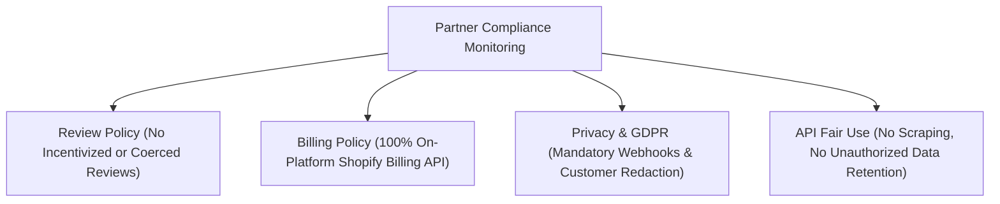

# SHOPIFY PARTNER GOVERNANCE & ENFORCEMENT

**Package:** `subhash/shopify-ai-audit`  
**Namespace:** `Subhash\ShopifyAiAudit\Shopify\Governance`  

---

## 1. Partner Program Policies & Agreements

Guardian tracks compliance against the following official Shopify agreements:
- **Shopify Partner Program Agreement (PPA):** General terms, revenue share, intellectual property, ethical conduct.
- **Shopify API License & Terms of Use:** API rate limits, non-compete clauses, caching limits, prohibited use of merchant data.
- **Shopify Acceptable Use Policy (AUP):** Fraud, malicious code, unsolicited marketing, deceptive listings.

---

## 2. Documented Enforcement Actions Registry

Shopify enforces violations across a spectrum of disciplinary actions:

```mermaid
graph LR
    subgraph MINOR["Visibility Restrictions"]
        A1["Review Editing / Removal"]
        A2["Promotional Badge Delisting"]
        A3["Search Ranking Penalties"]
    end

    subgraph MODERATE["Operational Restrictions"]
        B1["New Installation Freezes"]
        B2["Submission Review Suspension"]
        B3["Partner Payout Holds"]
    end

    subgraph CRITICAL["Severe Sanctions"]
        C1["App Delisting from App Store"]
        C2["Automated Uninstallation from Merchants"]
        C3["API Access Revocation"]
        C4["Partner Account Termination"]
    end

    MINOR --> MODERATE --> CRITICAL
```

---

## 3. App Removal Impact Analysis & Merchant Continuity

When an app faces enforcement removal or voluntary deprecation, Guardian generates an impact analysis:
- **Installed Merchant Risk:** Loss of order/fulfillment automation, broken theme blocks.
- **Data Export & Portability:** Provision of standard JSON/CSV exports for merchant data.
- **Webhook Deregistration:** Graceful teardown of event listeners.
- **Recurring Charge Cancellation:** Proper invocation of `appSubscriptionCancel` to prevent post-removal merchant billing disputes.

---

## 4. App Sunset Planner

For planned deprecations, Guardian offers a structured sunset timeline:
1. **T-90 Days:** Announce sunset to merchants via in-app banner and email; freeze new installs.
2. **T-60 Days:** Provide migration guides and data export tools.
3. **T-30 Days:** Second merchant reminder; provide alternative app recommendations.
4. **T-0 Days:** Cancel active billing subscriptions, deregister webhooks, archive merchant records according to privacy retention policies.
