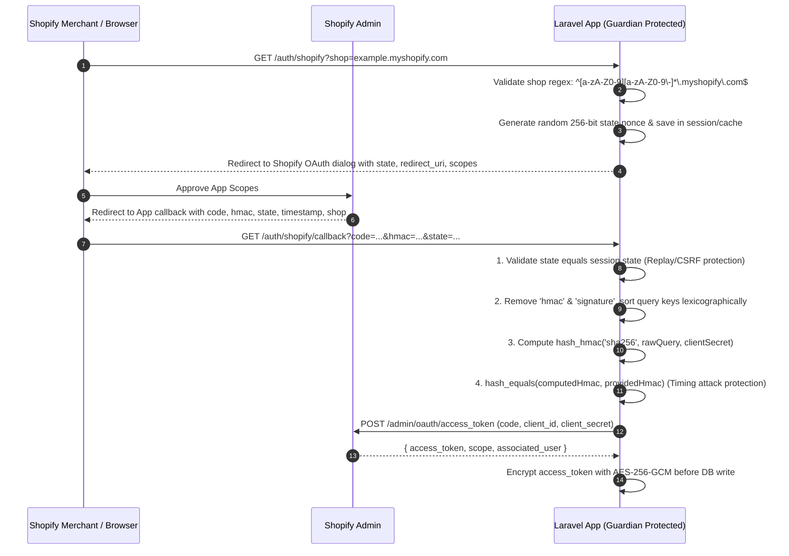
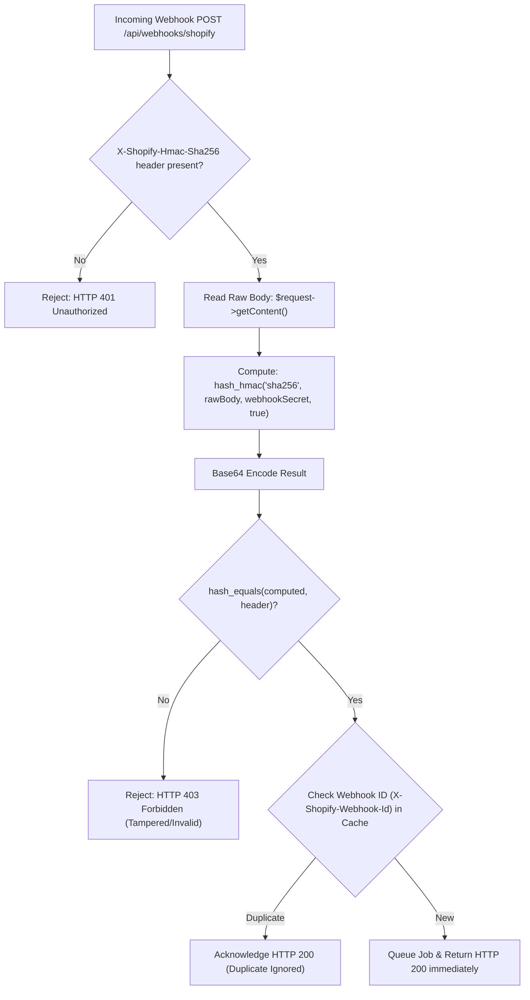

# SHOPIFY SECURITY SPECIFICATION

**Package:** `subhash/shopify-ai-audit`  
**Namespace:** `Subhash\ShopifyAiAudit\Shopify\Security`  

---

## 1. Authentication & OAuth 2.0 Security



### Critical Invariants
- **Domain Validation:** Every shop parameter MUST be validated against RFC-compliant myshopify subdomain regex before initiating any redirect.
- **Timing Attack Defense:** All HMAC and signature comparisons MUST use `hash_equals()`. Never use `===` or `==`.
- **State Validation:** The OAuth `state` parameter is mandatory and must expire within 10 minutes.

---

## 2. Webhook Signature & Payload Integrity



### Mandatory Compliance Webhooks
Under Shopify Partner Program and App Store Requirements, all public apps MUST handle mandatory privacy topics:
1. `customers/data_request` — Merchant or customer requests data held by the app.
2. `customers/redact` — Customer requests data erasure.
3. `shop/redact` — 48 hours after app uninstallation, merchant shop data must be erased.

The Guardian scanner verifies that routes and controller methods handling these topics exist, are HMAC-verified, and trigger appropriate asynchronous redaction/export jobs.

---

## 3. App Proxy Verification

Shopify App Proxies forward storefront requests to your app backend with a cryptographic signature query parameter.

Verification Algorithm:
1. Strip `signature` from the GET query array.
2. Sort parameters lexicographically by key.
3. Concatenate as key-value pairs (`key=value` or `key=val1,val2` for arrays).
4. Compute SHA-256 HMAC against the concatenated string using the client secret.
5. Verify via `hash_equals()` and check that `timestamp` is within an acceptable threshold (e.g., +/- 300 seconds) to prevent replay attacks.

---

## 4. Embedded App & Content Security Policy (CSP)

Embedded Shopify apps render inside an iframe in Shopify Admin.
- Traditional cookies fail due to browser third-party cookie restrictions.
- All embedded communication must use **Shopify App Bridge Session Tokens** (JWTs signed with app client secret).
- Responses must specify the CSP header:
  ```http
  Content-Security-Policy: frame-ancestors https://*.myshopify.com https://admin.shopify.com;
  ```
- Any X-Frame-Options header must NOT be set to `DENY` or `SAMEORIGIN`.

---

## 5. Theme & Extension Security

- **Liquid Escaping:** Untrusted user/merchant metafields and attributes rendered in Liquid templates must pass through `| escape` or `| json`.
- **ScriptTags Deprecation:** ScriptTag API is prohibited for new apps. Theme App Extensions with App Blocks and App Embeds must be used instead.
- **Shopify Functions & UI Extensions:** Network requests from UI extensions are restricted to declared hosts; customer data access in Checkout UI extensions must be bounded and declared in `shopify.extension.toml`.
